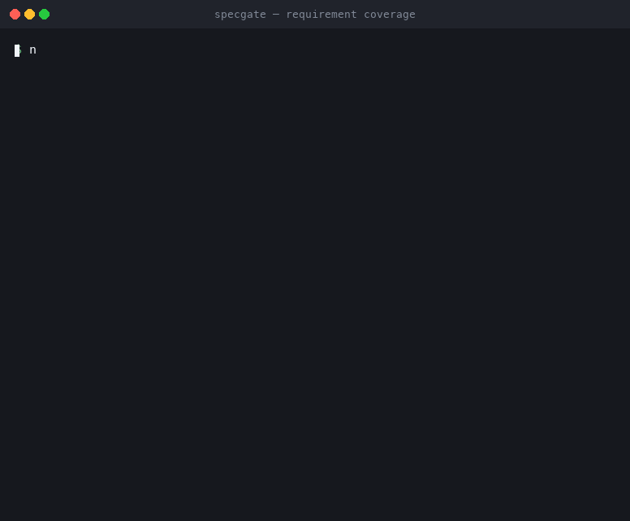

# specgate

**Requirement coverage for your codebase. Like test coverage, but for acceptance criteria.**

[](https://github.com/aazh2026/specgate/actions/workflows/ci.yml)
[](LICENSE)
[](https://nodejs.org)

Your tests pass. Your lint passes. But does the code actually do what the spec says?

`specgate` reads your acceptance criteria, finds the evidence for each one in your
codebase, and tells you which requirements are unproven. It is deterministic —
no LLM calls at runtime, no API key, no network. Same repo, same spec, same
score. Every time.



```bash
npx --yes --package=https://github.com/aazh2026/specgate/releases/download/v0.1.1/specgate-0.1.1.tgz specgate
```

```
  Requirement coverage: 80%  (5 criteria)

  ✔ covered    4
  ~ inferred   0
  ! untested   0
  ✗ uncovered  1

  Criterion                                    Status     Evidence
  ------------------------------------------------------------------------------
  AC-1         covered    #test/export.test.js:12
               User can export invoices as CSV
  AC-2         covered    #test/export.test.js:21
               Export respects the date range filter
  AC-5         uncovered  —
               Admin can schedule a recurring monthly export

  Gaps:
    AC-5  Admin can schedule a recurring monthly export
```

## Why

AI coding agents write code fast. The spec is where the truth lives — and it
rots first. Three months later nobody can tell whether `AC-12` is implemented,
half-implemented, or silently broken. Test coverage tells you *which lines ran*.
It tells you nothing about *which requirements exist*.

`specgate` closes that gap:

| | test coverage | requirement coverage |
|---|---|---|
| unit of measure | line / branch | acceptance criterion |
| answers | "is this code exercised?" | "is this requirement met?" |
| misses | a whole unimplemented feature | — |

## Install

```bash
# run without installing — no npm account, no registry token
npx --yes --package=https://github.com/aazh2026/specgate/releases/download/v0.1.1/specgate-0.1.1.tgz specgate

# or straight from the git tag
npx --yes github:aazh2026/specgate

# or with Homebrew
brew install aazh2026/specgate/specgate

# or clone and run it directly
git clone https://github.com/aazh2026/specgate
cd specgate && node bin/specgate.js
```

Requires Node.js 20+. No runtime dependencies.

> **Coming to npm.** The publish pipeline is wired up, but the package is not on
> the registry yet — `npx specgate` will 404 until it is. Use the release
> tarball form above in the meantime; it runs the exact same published
> tarball and needs no npm account.

## Quick start

If your project has no written spec yet, scaffold one:

```bash
npx --yes --package=https://github.com/aazh2026/specgate/releases/download/v0.1.1/specgate-0.1.1.tgz specgate init
```

That writes a starter `SPEC.md` with the acceptance criteria already structured,
plus a `.github/workflows/requirements.yml` CI gate. It detects your stack
(language, test runner, package manager) so the scaffold matches your project.

Then edit the criteria, tag your tests, and scan:

```bash
npx --yes --package=https://github.com/aazh2026/specgate/releases/download/v0.1.1/specgate-0.1.1.tgz specgate
```

## Usage

```bash
specgate                                  # auto-discover the spec, print a report
specgate --spec docs/SPEC.md              # point it at a specific spec
specgate --format json                    # machine-readable output
specgate --min 80                         # fail CI below 80% coverage
specgate --fail-uncovered                 # fail if anything is uncovered
specgate --sarif-out specgate.sarif       # upload to GitHub code scanning
```

| Flag | Meaning |
|---|---|
| `--spec <file>` | Spec file to read. Repeatable. |
| `--format <fmt>` | `text` (default), `json`, or `sarif` |
| `--min <n>` | Exit 1 if the coverage score is below `n` |
| `--fail-uncovered` | Exit 1 if any criterion has no evidence |
| `--fail-untested` | Exit 1 if any criterion is implemented but untested |
| `--json-out <file>` | Write the JSON report to a file |
| `--sarif-out <file>` | Write a SARIF report for GitHub code scanning |
| `--force` | With `init`: overwrite existing files |
| `--name <name>` | With `init`: project name for the spec title |
| `-v`, `--verbose` | Show every criterion, not just the gaps |

## How it works

`specgate` does four things, all locally:

**1. Parse the spec.** It finds your acceptance criteria and gives each one a
stable id. If you wrote ids, it keeps them. If you didn't, it mints `AC-1`,
`AC-2`, … in document order, so the tool still works on a plain bullet list.

```markdown
## Acceptance Criteria

- [ ] AC-1: User can export invoices as CSV
- [ ] [AC-2] Export respects the date range filter
- [ ] Export fails loudly when the storage backend is unavailable
```

**2. Index the code.** It walks your repo for source and test files, skipping
`node_modules`, `dist`, and friends. Identifier boundaries are respected:
`resetPassword`, `export_csv`, and `HTTPResponse` are all split correctly, so a
criterion written in English prose can match code written in camelCase.

**3. Find evidence, in tiers.**

| Tier | Status | What it means |
|---|---|---|
| `tagged` | `covered` | An explicit marker — `// AC-1`, `# AC-1`, `[AC-1]` — points at the criterion. |
| `named` | `inferred` | A test name matches the criterion's distinctive words. A hint, not a guarantee. |
| `text` | `untested` | Only implementation code matched. Nothing pins the behaviour down. |
| — | `uncovered` | No evidence anywhere. |

**4. Score.** Evidence tiers are weighted, because they are not equally
trustworthy:

```
score = 100 × (covered×1.0 + inferred×0.75 + untested×0.4 + uncovered×0.0) / total
```

`inferred` is discounted on purpose. A test named `resetPassword` might test
something else entirely. Only an explicit tag is worth full credit.

## Using it in CI

The quickest way in:

```yaml
# .github/workflows/requirements.yml
name: Requirement coverage
on: [pull_request]

jobs:
  specgate:
    runs-on: ubuntu-latest
    steps:
      - uses: actions/checkout@v4
      - uses: aazh2026/specgate@v0.1.1
        with:
          min: 80
          fail-uncovered: true
```

The action exposes the score as an output:

```yaml
      - id: specgate
        uses: aazh2026/specgate@v0.1.1
      - run: echo "Coverage was ${{ steps.specgate.outputs.score }}%"
```

Or run the CLI directly:

```yaml
      - uses: actions/setup-node@v4
        with: { node-version: 20 }
      - run: npx --yes github:aazh2026/specgate --min 80 --fail-uncovered
```

The gate is the point. A spec that says "the user can export invoices as CSV"
should stop a pull request that doesn't implement it.

For GitHub code scanning, upload the SARIF report:

```yaml
      - run: npx --yes github:aazh2026/specgate --sarif-out specgate.sarif --format sarif
      - uses: github/codeql-action/upload-sarif@v3
        with:
          sarif_file: specgate.sarif
```

Or let the action do it:

```yaml
      - uses: aazh2026/specgate@v0.1.1
        with:
          sarif: specgate.sarif
      - uses: github/codeql-action/upload-sarif@v3
        with:
          sarif_file: specgate.sarif
```

## Spec format

Anything Markdown works. `specgate` looks for a heading matching
`acceptance criteria`, `acceptance`, `requirements`, `user stories`, `criteria`
(or `验收标准` / `需求` / `用户故事`), and treats the bullets under it as criteria.

Criteria without an explicit id still get one. If your team prefers plain
prose, this is enough:

```markdown
## Acceptance Criteria

- User can export invoices as CSV
- Export respects the date range filter
```

If your team already numbers things, use it:

```markdown
## Acceptance Criteria

- [ ] AC-1: User can export invoices as CSV
- [ ] REQ-12: Export respects the date range filter
```

### Adding explicit tags

To move a criterion from `inferred` to `covered`, point at it:

```js
// AC-1: User can export invoices as CSV
test('exports invoices as CSV', () => { /* ... */ });
```

```python
# AC-2: Export respects the date range filter
def test_export_respects_date_range():
    ...
```

## API

```js
import { runSpecgate } from 'specgate';

const report = runSpecgate({ root: process.cwd(), specFiles: ['docs/SPEC.md'] });

report.summary;          // { score, total, covered, inferred, untested, uncovered }
report.criteria;         // [{ id, text, status, evidence: { tier, file, line } }]
report.stats;            // { filesScanned, testFiles }
```

## Limitations

Being honest about what this is:

- **It matches text, not meaning.** A criterion written as *"the operator can
  revoke a session"* will not match a function called `deleteToken` unless the
  words overlap. Use explicit tags for anything that matters.
- **`inferred` is a heuristic.** It is weighted down for that reason, but it is
  not proof.
- **English and Chinese prose both tokenise**, but a spec mixing languages
  works best when criteria are written in the language that matches the code
  identifiers.
- **It is not a test runner.** It does not know whether your tests pass. Pair it
  with your existing test suite.

## Contributing

Issues and pull requests are welcome. Run the tests with:

```bash
npm test
```

## License

MIT
